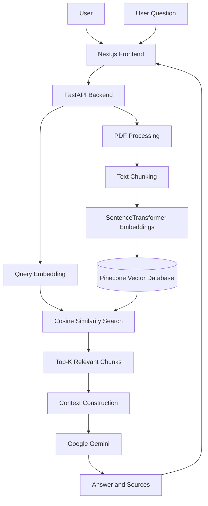

# ResearchPaperAI 📚🤖
[**Live Demo →**](https://research-paper-ai-sigma.vercel.app/)

**An AI-powered research assistant that helps users search, understand, compare, and synthesize academic research papers using Retrieval-Augmented Generation (RAG).**

ResearchPaperAI allows users to upload research papers in PDF format, ask questions about their contents, compare multiple papers, and generate literature reviews around a research topic. By combining semantic search with a large language model, the system retrieves relevant passages from research documents and uses them as context for generating evidence-grounded responses.

## 🚀 Features

- **PDF Upload and Processing:** Upload research papers in PDF format for processing and retrieval.
- **Semantic Search:** Find relevant passages based on the meaning of a query rather than relying only on exact keyword matches.
- **AI-Powered Question Answering:** Ask natural-language questions about research papers and receive answers grounded in retrieved document content.
- **Multi-Paper Comparison:** Compare multiple research papers to identify similarities, differences, and key findings.
- **Literature Review Generation:** Generate topic-focused literature reviews using selected research papers.
- **Source References:** Return source information associated with retrieved passages, including paper names and page numbers where available.
- **Vector Search:** Store document embeddings and retrieve relevant chunks using Pinecone.
- **Web-Based Interface:** Interact with the research assistant through a frontend connected to a Python backend.

## 🧠 How It Works

ResearchPaperAI follows a Retrieval-Augmented Generation (RAG) architecture.

1. **Document Upload:** A user uploads a research paper in PDF format through the frontend.
2. **PDF Validation:** The backend validates the uploaded file and checks whether its text can be extracted.
3. **Text Extraction and Chunking:** The paper's text is divided into smaller chunks so that relevant sections can be retrieved independently.
4. **Embedding Generation:** The SentenceTransformer model `all-MiniLM-L6-v2` converts each text chunk into a 384-dimensional vector embedding. Embeddings are normalized.
5. **Vector Storage:** The embeddings and associated metadata are stored in Pinecone.
6. **Query Processing:** When a user asks a question, the question is converted into an embedding using the same model.
7. **Semantic Retrieval:** Pinecone uses cosine similarity to retrieve the most relevant document chunks.
8. **Context Construction:** The retrieved passages are assembled into context for the language model.
9. **Response Generation:** Google Gemini generates a response using the retrieved research content.
10. **Source Presentation:** The application returns the answer alongside relevant source information.

### Architecture



## 🛠️ Technology Stack

| Component | Technology | Purpose |
|---|---|---|
| Frontend | Next.js, React | User interface and interactions |
| Backend | Python, FastAPI | API endpoints and application logic |
| Embedding Model | SentenceTransformers — `all-MiniLM-L6-v2` | Generate text embeddings |
| Vector Database | Pinecone | Store and retrieve document vectors |
| Similarity Metric | Cosine similarity | Rank semantically similar vectors |
| Large Language Model | Google Gemini | Generate contextual answers |
| PDF Processing | PyMuPDF | Extract text from PDF documents |
| Data Validation | Pydantic | Validate structured API requests |
| Deployment | Vercel and Railway | Host the frontend and backend |

## 🔍 Retrieval Methodology

The application uses dense vector retrieval to identify research passages relevant to a user's question.

- **Embedding dimensions:** 384
- **Embedding normalization:** Enabled
- **Vector similarity metric:** Cosine similarity
- **Current Pinecone vector count:** 1,865 at the time of the latest index check
- **Default retrieval count:** Top 5 chunks for the question-answering workflow

Each document chunk is represented by a vector and associated metadata, such as the paper name, page number, chunk identifier, and text.

At query time, the user's question is embedded using the same model. Pinecone ranks stored vectors according to cosine similarity and returns the most relevant matches.

The retrieved passages provide the context used by Gemini to formulate an answer. This approach helps connect generated responses to the research material rather than relying exclusively on the language model's pretrained knowledge.

*Note: The vector count reflects the index at the time it was checked and may change as documents are uploaded or updated.*

## 📂 Project Structure

```text
ResearchPaperAI/
├── backend/
│   ├── main.py
│   ├── chunking.py
│   ├── embeddings.py
│   ├── upload_vectors.py
│   ├── upload_single_pdf.py
│   ├── retrieval.py
│   ├── search.py
│   ├── rag.py
│   ├── ingest.py
│   ├── evaluate_retrieval.py
│   ├── pinecone_test.py
│   └── requirements.txt
│
├── frontend/
│   └── Next.js application
│
├── .gitignore
└── README.md
```

### Key Backend Modules

- **`main.py`** — Defines FastAPI endpoints for uploading documents, asking questions, comparing papers, and generating literature reviews.
- **`chunking.py`** — Extracts PDF text and splits it into smaller chunks.
- **`embeddings.py`** — Generates normalized embeddings using SentenceTransformers.
- **`upload_vectors.py`** — Generates embeddings and uploads vectors with metadata to Pinecone for batch ingestion.
- **`upload_single_pdf.py`** — Handles the single-PDF ingestion workflow used by the upload endpoint.
- **`retrieval.py`** — Provides document retrieval functionality for the application.
- **`rag.py`** — Contains RAG-related functionality used for retrieval and context preparation.
- **`search.py`** — Demonstrates semantic search against the Pinecone index.
- **`ingest.py`** — Provides a PDF text-extraction diagnostic workflow.
- **`evaluate_retrieval.py`** — Inspects retrieved passages for a set of test questions.
- **`pinecone_test.py`** — Checks connectivity and statistics for the Pinecone index.

## ⚙️ Getting Started

### Prerequisites

Before running the project locally, ensure you have:

- Python installed
- Node.js and npm installed
- A Pinecone account and API key
- A Google Gemini API key

### 1. Clone the Repository

```bash
git clone https://github.com/Tarun250506/ResearchPaperAI.git
cd ResearchPaperAI
```

### 2. Set Up the Backend

```bash
cd backend
python -m venv .venv
```

Activate the virtual environment.

**macOS / Linux:**

```bash
source .venv/bin/activate
```

Install the dependencies:

```bash
pip install -r requirements.txt
```

### 3. Configure Environment Variables

Create a `.env` file inside the `backend/` directory:

```env
PINECONE_API_KEY=your_pinecone_api_key
GEMINI_API_KEY=your_gemini_api_key
```

Replace the placeholder values with your own credentials. Never commit API keys or other secrets to GitHub.

### 4. Run the Backend

From the `backend/` directory, start the FastAPI server:

```bash
uvicorn main:app --reload
```

The local API should be accessible at:

```text
http://127.0.0.1:8000
```

FastAPI's interactive API documentation is available at:

```text
http://127.0.0.1:8000/docs
```

### 5. Run the Frontend

Open a separate terminal:

```bash
cd frontend
npm install
npm run dev
```

Open the local frontend URL displayed by Next.js, typically:

```text
http://localhost:3000
```

Ensure that the frontend is configured to communicate with the correct backend URL.

## 🌐 Deployment

The application is deployed using separate services for the frontend and backend.

- **Frontend:** Vercel
- **Backend:** Railway
- **Vector Database:** Pinecone
- **LLM Provider:** Google Gemini

The deployed frontend communicates with the FastAPI backend through HTTP API requests. The backend handles document processing, retrieval, and language-model calls.

Production environment variables must be configured in the relevant deployment service settings.

## 🧪 Testing and Evaluation

The project includes utilities for checking vector database connectivity and inspecting retrieval results.

- `pinecone_test.py` checks Pinecone connectivity and index statistics.
- `search.py` allows manual queries against the vector index.
- `evaluate_retrieval.py` runs predefined research questions and displays retrieved passages, similarity scores, and the number of distinct papers represented.

These utilities support qualitative inspection of retrieval behavior. The current retrieval evaluation script is diagnostic; it does not, by itself, calculate formal metrics such as Precision@K, Recall@K, Mean Reciprocal Rank (MRR), or Normalized Discounted Cumulative Gain (NDCG).

## 🔮 Future Improvements

Potential directions for extending ResearchPaperAI include:

- **Retrieval Evaluation:** Add labeled test datasets and quantitative retrieval metrics.
- **Reranking:** Introduce a reranking model to improve the ordering of retrieved passages.
- **Hybrid Search:** Combine dense vector retrieval with keyword-based search.
- **Citation Accuracy:** Improve citation traceability and verify that claims are supported by specific passages.
- **Advanced Document Parsing:** Improve handling of tables, equations, figures, and scanned research papers.
- **Streaming Responses:** Stream generated answers to improve user experience.
- **Research Knowledge Graph:** Connect papers, authors, methods, datasets, and findings to support more complex research questions.
- **Scalability:** Optimize ingestion, retrieval, and processing for larger document collections.

## 🎯 Project Objective

The goal of ResearchPaperAI is to make academic research more accessible by reducing the effort required to search through papers, understand findings, compare methodologies, and synthesize information across multiple sources.

By combining semantic retrieval, vector databases, and generative AI, the project provides a foundation for a more efficient and context-aware research workflow.

## 👨‍💻 Author

**Tarun Vijan**

GitHub: [@Tarun250506](https://github.com/Tarun250506)

---

*Built with Python, FastAPI, Next.js, Pinecone, SentenceTransformers, and Google Gemini.*
